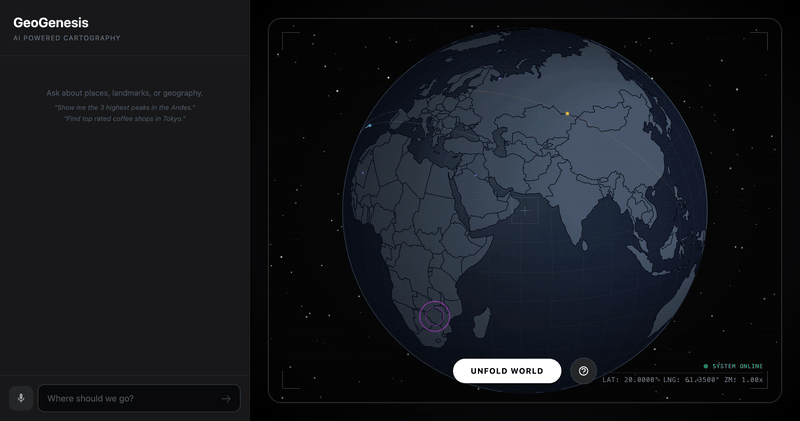
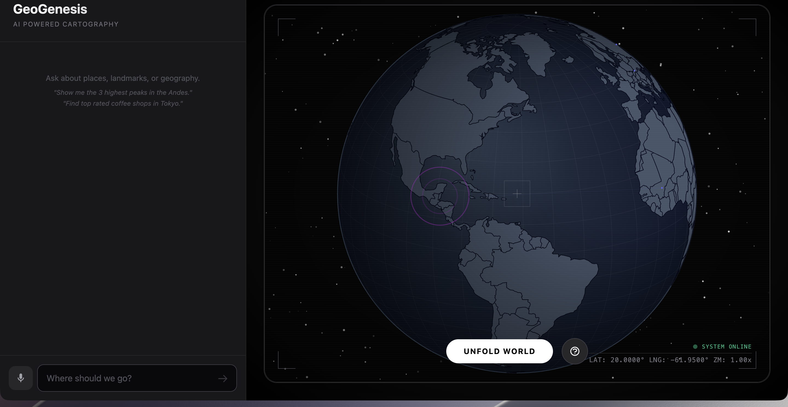
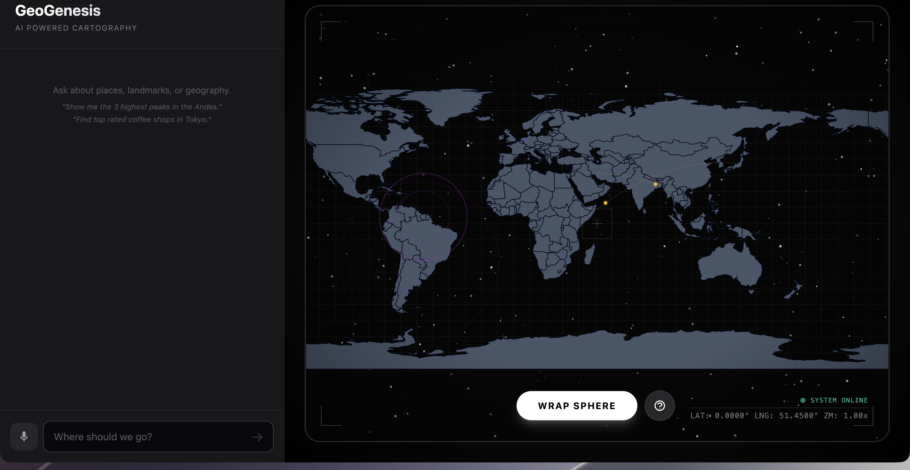

# GeoGenesis

An interactive 3D globe powered by AI. Ask about any place on Earth — the globe spins to it, drops markers, and the AI tells you what's there. Click any country to explore it. Unfold the globe into a flat map with a smooth morphing animation.



## Quick Start

```bash
git clone https://github.com/AndrewVoirol/ais-geogenesis-ai-unfolding-globe.git
cd ais-geogenesis-ai-unfolding-globe
npm install
npm run dev
```

Open `http://localhost:3000` — the globe works immediately without an API key.

To enable AI chat: copy `.env.example` to `.env.local` and add your [Gemini API key](https://aistudio.google.com/apikey).

## How It Works

**Interact**: Drag to rotate, scroll to zoom, click any country to fly there. Type or speak a question in the chat panel — "Show me the 3 highest peaks in the Andes" — and the globe animates to the locations while the AI describes them.

**Unfold**: Hit the button to morph between 3D globe and 2D flat map. The projection interpolates between orthographic and equirectangular in real-time on Canvas 2D.

The globe renders on a `requestAnimationFrame` loop drawing to Canvas 2D using D3's `geoProjection` with a custom interpolation function. Country hit-testing uses a color-picking technique on an off-screen canvas. Procedural overlays (flight paths, shipping routes, data connections) and ambient effects (starfield parallax, CRT scanlines, click ripples) run continuously.



## Features

- 🌐 3D globe ↔ 2D flat map morph animation
- 💬 AI chat with Gemini — ask about any place, get markers + descriptions
- 🗺️ Google Search & Maps grounding for verified coordinates and links
- 🎯 Click any country → fly-to animation + cinematic title overlay
- 🎙️ Voice input via Web Speech API
- ✈️ Procedural flight paths, shipping routes, and data connections
- ⭐ Parallax starfield with twinkling
- 📡 HUD overlay: crosshairs, corner brackets, coordinate telemetry
- 🔊 Audio feedback (oscillator-based SFX on hover/click)
- 📺 CRT scanline effect and vignette
- 🖱️ Drag rotation, scroll zoom, pinch-to-zoom on touch

## Tech Stack

| Layer | Technology |
|-------|------------|
| Framework | React 19 + TypeScript |
| Build | Vite 6 |
| Styling | Tailwind CSS 3 |
| Visualization | D3.js v7 + TopoJSON + Canvas 2D |
| AI | `@google/genai` SDK → Gemini 2.5 Flash |
| Voice | Web Speech API (native browser) |
| Map Data | [world-atlas](https://cdn.jsdelivr.net/npm/world-atlas@2/countries-110m.json) (runtime CDN) |

## Project Structure

```
├── index.html              # Entry HTML
├── index.css               # Base styles + animations
├── index.tsx               # React mount point
├── App.tsx                 # Root component, state orchestration
├── types.ts                # TypeScript interfaces
├── components/
│   ├── GlobeViz.tsx        # D3 projections, Canvas render loop, hit testing,
│   │                       #   drag, zoom, audio, connections, ripples, HUD
│   ├── ChatInterface.tsx   # Chat panel with voice input, grounding chips
│   └── TutorialOverlay.tsx # First-run modal explaining controls
├── services/
│   └── geminiService.ts    # Gemini API integration + response parsing
└── screenshots/            # README assets
```

## API Key Notes

The globe, animations, and all visual features work without an API key. The AI chat features require a [Gemini API key](https://aistudio.google.com/apikey) set in `.env.local`.

The service uses `googleMaps` and `googleSearch` grounding tools — these may require specific key permissions. If grounding isn't available, the model still provides coordinates from its training data.

## License

MIT
